<p align="center">
  
</p>

<h1 align="center">llm-speedtest</h1>

<p align="center">
  <b>Availability · latency · load · capability · quality benchmarks for any OpenAI-compatible LLM API.</b><br>
  One static binary: CLI, interactive dashboard, detailed Markdown reports, MCP server and an installable AI skill.
</p>

<p align="center">
  <a href="https://github.com/AnnaofArendelle/llm-speedtest/actions/workflows/ci.yml"></a>
  <a href="https://github.com/AnnaofArendelle/llm-speedtest/releases/latest"></a>
  <a href="https://goreportcard.com/report/github.com/AnnaofArendelle/llm-speedtest"></a>
  
  <a href="https://github.com/AnnaofArendelle/llm-speedtest/pkgs/container/llm-speedtest"></a>
  <a href="docs/skill.md"></a>
  <a href="LICENSE"></a>
</p>

<p align="center">
  <a href="README.zh-CN.md">简体中文</a> ·
  <a href="#quick-start">Quick start</a> ·
  <a href="#screenshots">Screenshots</a> ·
  <a href="#how-the-scan-works">How it works</a> ·
  <a href="docs/metrics.md">Metrics</a> ·
  <a href="docs/skill.md">AI skill</a> ·
  <a href="docs/api.md">HTTP API</a>
</p>

<picture>
  <source media="(prefers-color-scheme: dark)" srcset="docs/screenshots/dashboard-dark.png">
  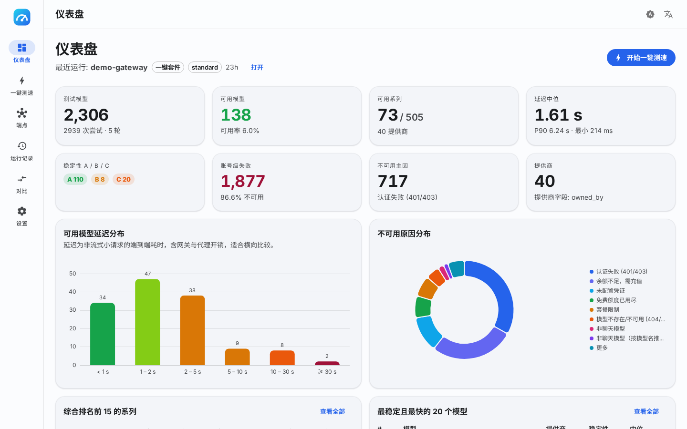
</picture>

## Why llm-speedtest?

Gateways and routers happily list hundreds or thousands of models. Many of those entries are dead, locked,
out of quota, mislabelled or simply slow — and a single request tells you nothing about stability.
llm-speedtest grew out of a real audit of a 2 306-model multi-provider gateway and turns that method into a tool:

- **Multi-round availability scan.** Every model is probed in several rounds — full sweep → retry of transient
  failures → re-sampling of successes → final confirmation — with per-provider concurrency limits and lock-aware
  cooldowns. "Available" means *repeatedly* available.
- **25 actionable failure reasons.** Gateway wrappers are unwrapped and the upstream error is classified
  (auth, balance, missing credentials, free tier exhausted, not a chat model, provider 5xx, timeouts, …) so you
  know whether to fix a key, top up a balance or drop a route.
- **Rankings that answer the real question.** Model families are ranked by *stability × provider breadth × speed*
  and by stability alone; every model gets an A/B/C tier from its multi-round success rate.
- **Nothing hard-coded.** Providers and families are inferred from what the endpoint actually returns
  (`owned_by`, id prefixes, connection ids inside errors, served model names, context sizes) and can be corrected
  per endpoint. New gateways, aliases and naming schemes just work — there is no alias table to maintain.
- **Deeper when you need it.** A streaming latency lab (TTFT, TPOT, tok/s), closed-loop and open-loop load tests
  with goodput, 13 capability probes and a deterministic quality spot-check that flags mislabelled models.
- **Built for people *and* agents.** Dashboard and Markdown/JSON/CSV exports for humans; `--json` output, an MCP
  server and an [Agent Skills](https://agentskills.io) package for AI assistants.

## Features

| Module | What it does | Dashboard |
|---|---|---|
| **Endpoints** | Multiple endpoint profiles, dialect auto-detection, encrypted key storage, connectivity/auth check, model preview | Endpoint cards |
| **Availability scan** | Discovery → filters → multi-round probing → failure classification → dynamic family grouping → tiers → composite ranking → provider resolution | KPI cards, latency histogram, reason donut, composite & stability rankings, all-model table, provider table, failure list, family drawer |
| **Latency lab** | Streaming requests: TTFT, time-to-second-token, TPOT, ITL, E2E, decode tok/s (N−1), input tok/s, cold start, p50–p99 | Gauges, grouped bars, per-model stats |
| **Load test** | Closed-loop concurrency sweep or open-loop Poisson rate, ramp-up, request/token throughput, error rate, goodput under an SLO | Concurrency → throughput/latency curve |
| **Capability probes** | streaming, `include_usage`, tools, JSON mode, JSON schema, vision, system prompt, `max_tokens`, `stop`, determinism, reasoning params, long-context tiers, embeddings | Capability matrix |
| **Quality spot-check** | ~20 deterministic questions (YAML, extensible), repeated trials, consistency, self-reported identity | Score table with category pass rates |
| **Suite** | scan → latency (top N) → capability → quality → optional load, in one command or one click | Combined run dashboard with live SSE progress, in-flight list and per-model **skip** |
| **Capability matrix** | Eight-axis radar per model and per family (stability, speed, breadth, TTFT, throughput, capabilities, quality, load) with stage coverage | Model / family drawers |
| **Export & compare** | Markdown report with the full detailed structure, JSON (schema-versioned), CSV, run-to-run diff | Export tab, Compare page |
| **AI skill & MCP** | `SKILL.md` package, MCP server (`llm-speedtest mcp`) with 20 tools, self-installer | — |
| **Demo mode** | `serve --demo` seeds an anonymised reference scan so you can explore the UI without an endpoint | — |

## Screenshots

<table>
  <tr>
    <td width="50%">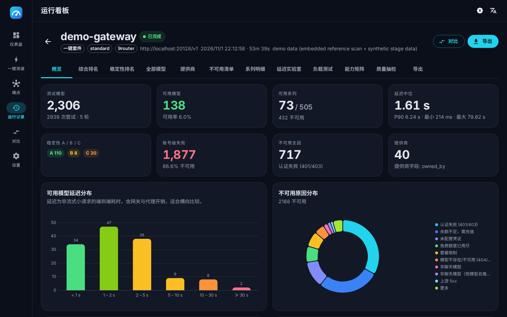</td>
    <td width="50%">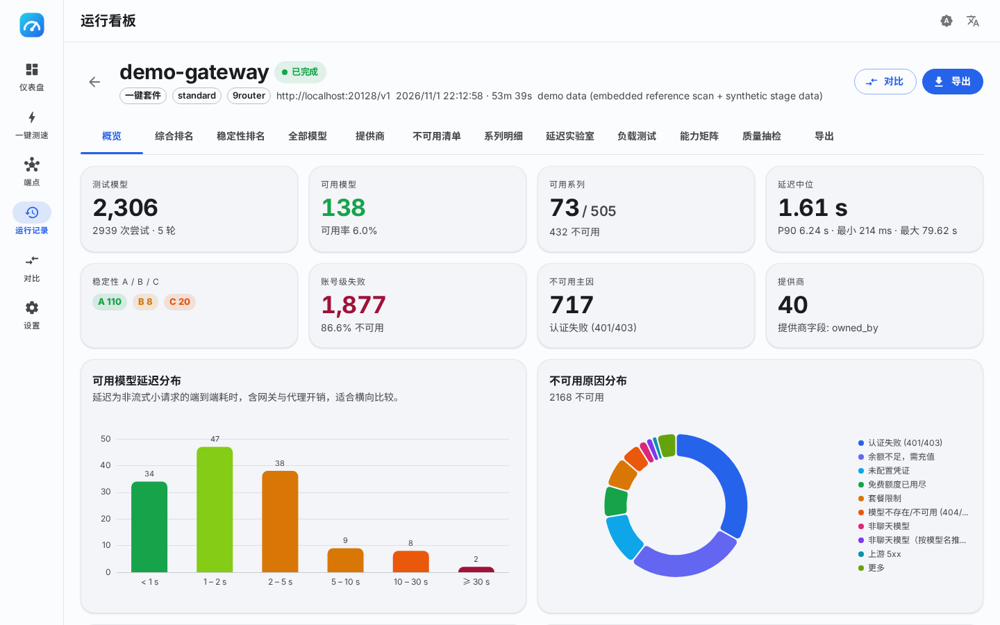</td>
  </tr>
  <tr>
    <td align="center">Run overview · dark</td>
    <td align="center">Run overview · light</td>
  </tr>
  <tr>
    <td>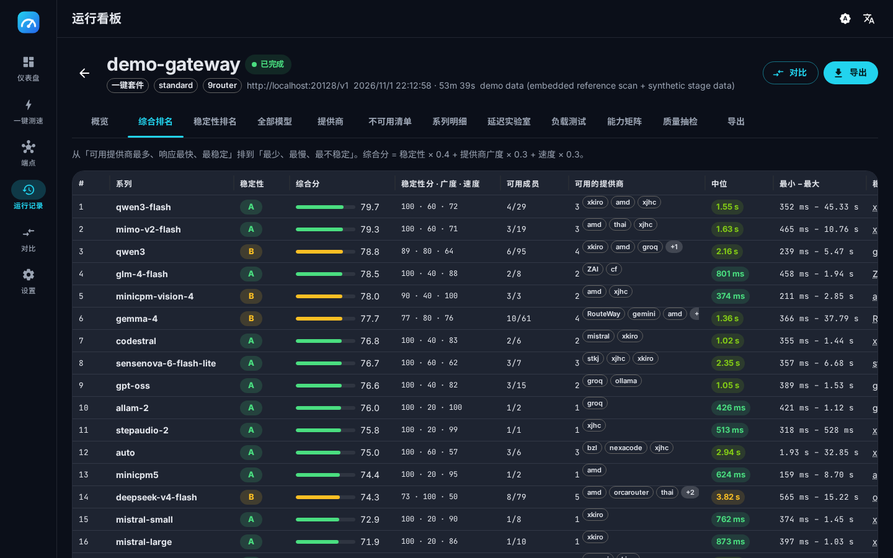</td>
    <td>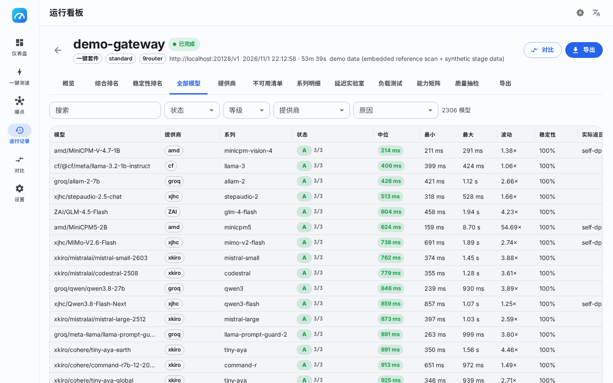</td>
  </tr>
  <tr>
    <td align="center">Composite family ranking</td>
    <td align="center">All models with filters and server-side sorting</td>
  </tr>
  <tr>
    <td>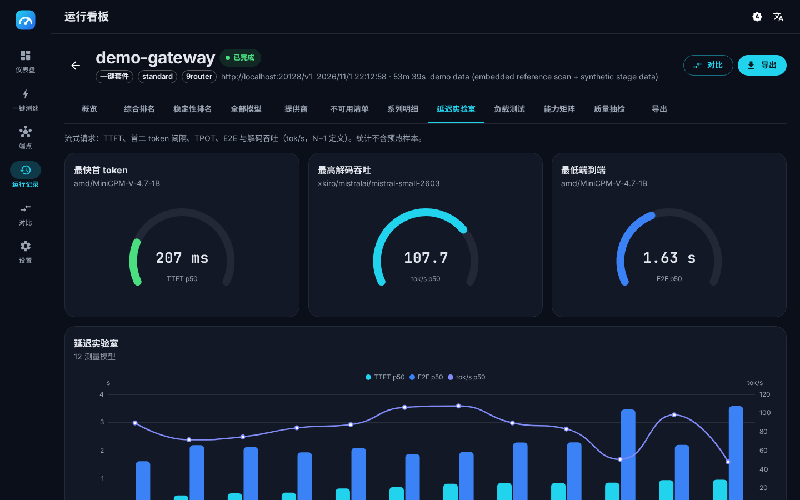</td>
    <td>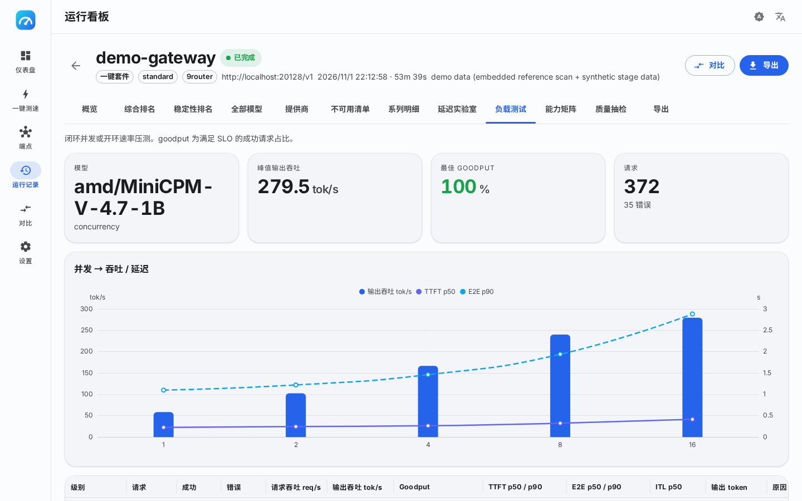</td>
  </tr>
  <tr>
    <td align="center">Latency lab</td>
    <td align="center">Load test</td>
  </tr>
  <tr>
    <td>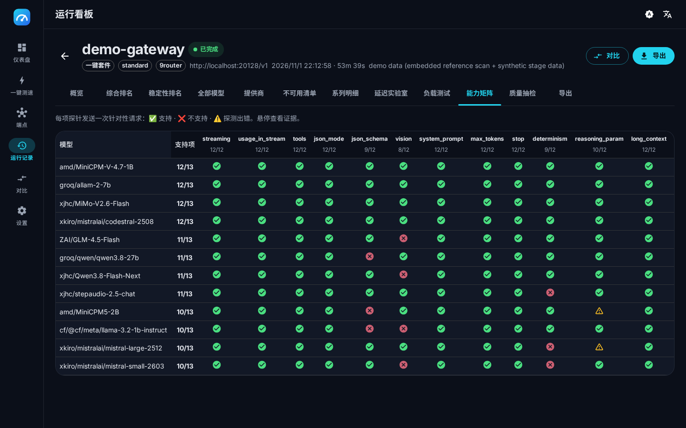</td>
    <td>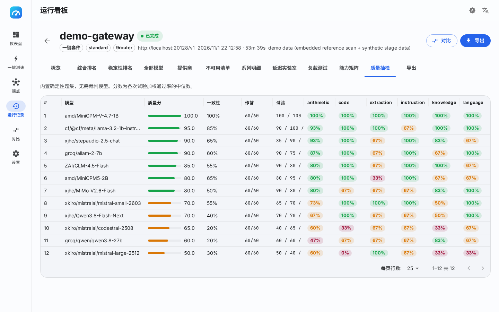</td>
  </tr>
  <tr>
    <td align="center">Capability matrix</td>
    <td align="center">Quality spot-check</td>
  </tr>
  <tr>
    <td>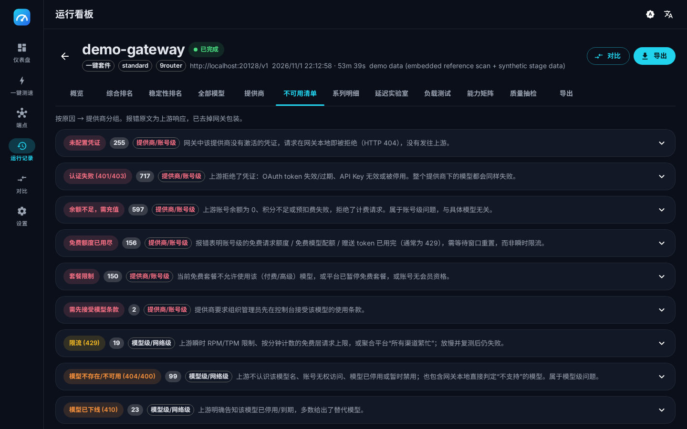</td>
    <td>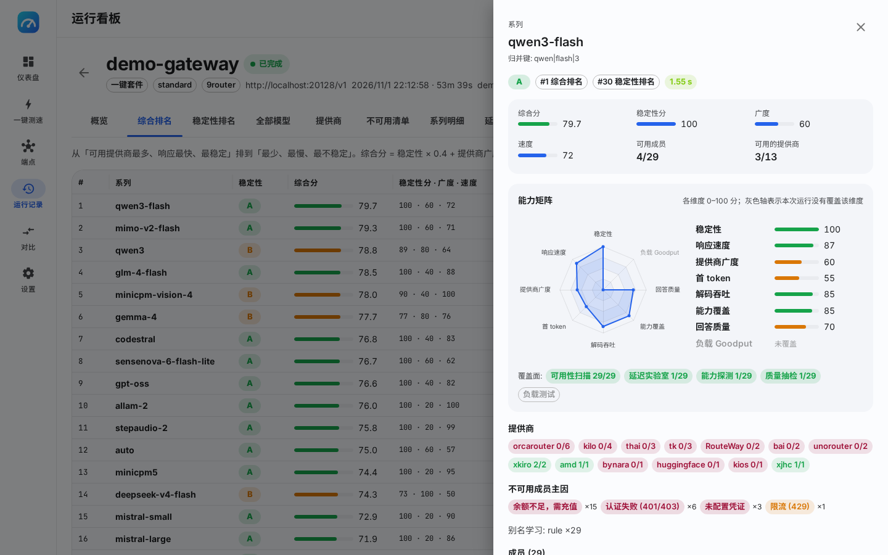</td>
  </tr>
  <tr>
    <td align="center">Failures grouped by reason → provider</td>
    <td align="center">Family drawer with grouping evidence</td>
  </tr>
  <tr>
    <td>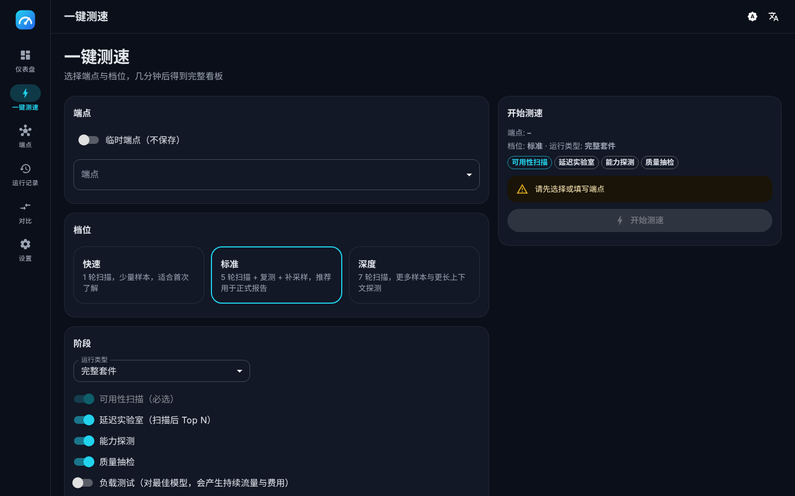</td>
    <td>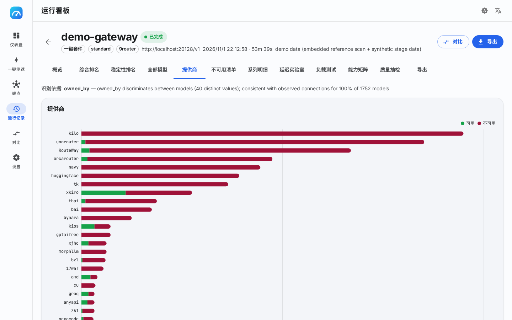</td>
  </tr>
  <tr>
    <td align="center">One-click speed test wizard</td>
    <td align="center">Providers with identification evidence</td>
  </tr>
</table>

<p align="center">
  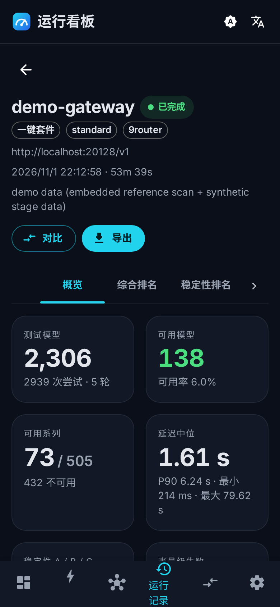
  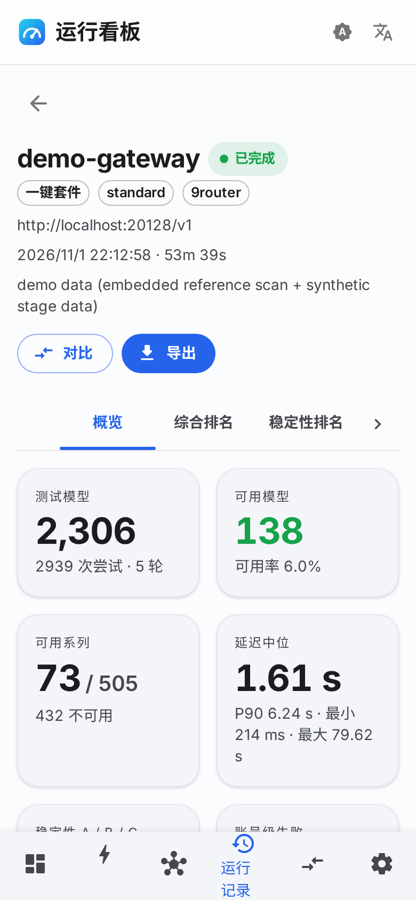
</p>

## Quick start

### Install

```sh
# Linux / macOS — latest release, checksum verified
curl -fsSL https://raw.githubusercontent.com/AnnaofArendelle/llm-speedtest/main/scripts/install.sh | sh

# Docker (multi-arch; data persisted in a volume)
docker run --rm -p 8787:8787 -v llm-speedtest:/data ghcr.io/annaofarendelle/llm-speedtest:latest

# Windows — download the zip from the releases page
```

Release binaries and the container image embed the web dashboard. `go install github.com/AnnaofArendelle/llm-speedtest/cmd/llm-speedtest@latest`
gives you the CLI, HTTP API and MCP server without the dashboard (build it with `make web` first if you need it).

### 1 · Open the dashboard

```sh
llm-speedtest serve            # http://127.0.0.1:8787
llm-speedtest serve --demo     # explore the UI with the bundled reference data
```

Add an endpoint (base URL ending in `/v1` + key), click **Speed test**, pick a profile and watch results stream in.

### 2 · Or run from the terminal

```sh
export LLM_SPEEDTEST_KEY=sk-...

# everything: scan → latency → capabilities → quality, Markdown + JSON exports
llm-speedtest suite --url https://gateway.example.com/v1 --profile standard --out report.md --json-out report.json

# availability scan of a subset, quick profile
llm-speedtest scan --url http://localhost:20128/v1 --include-owner groq --include-owner cf --profile quick

# streaming latency of specific models
llm-speedtest latency --url https://gateway.example.com/v1 --model openai/gpt-oss-120b --samples 10

# load test (sends sustained traffic — must be confirmed)
llm-speedtest load --url https://gateway.example.com/v1 --model openai/gpt-oss-120b --levels 1,2,4,8 --duration 30s --confirm

# stored runs, reports and diffs
llm-speedtest runs
llm-speedtest report --run <id> --format md --lang en
llm-speedtest compare --a <id> --b <id>
```

```
scan  round 1/5 (first)    1240/2306  ✓ 131  ✗ 1109  eta 2m10s
scan  round 2/5 (retry)     208/208   ✓ 7    ✗ 201
...
models 2306 · available 138 (6.0%) · A/B/C 110/8/20 · families 505 (73 available) · median 1.61s
```

Every command accepts `--config speedtest.yaml` (see [`examples/speedtest.yaml`](examples/speedtest.yaml)) and
produces machine-readable output with `--json` / `--json-out`.

### 3 · Let your AI assistant do it

```sh
llm-speedtest skill install --target claude   # or codex | cursor | <directory>
llm-speedtest mcp                              # MCP server over stdio
```

After installing the skill, ask your assistant *"which models on http://localhost:20128/v1 actually work, and
which are fastest?"* — it will run the scan, read the ranking and write the summary. See [docs/skill.md](docs/skill.md)
and [docs/mcp.md](docs/mcp.md).

## How the scan works

| Round | Purpose | Default (standard profile) |
|---|---|---|
| 1 · first | Probe every model once (`max_tokens: 1`, prompt `hi`) | 10 global / 2 per provider, 60 s timeout |
| 2 · retry | Re-probe transient failures (timeouts, 5xx, rate limits) after cooldowns | 6 / 1, 90 s |
| 3..N · resample | Re-probe successes to measure stability and jitter | 2 extra rounds |
| final | Confirm every model that succeeded at least once | 4 / 1, 90 s |

Each attempt records HTTP status, upstream status, connection id, latency, served model and the classified
reason. From the attempts the analyser derives:

- **Model tier** from the multi-round success rate: **A** ≥ 99.9 %, **B** ≥ 66 %, **C** below.
- **Family** of each model via tokeniser rules (version folding, size/quantisation stripping, modifier words)
  plus alias learning from served model names, abbreviation expansion against the endpoint's own vocabulary and
  per-endpoint overrides. Generic pseudo-models (`auto`, `free`, …) never absorb other families.
- **Provider** of each model by picking the field with the best *discriminating power* and *consistency*
  with connection ids seen in errors — `owned_by`, the id prefix, or the endpoint itself.
- **Composite family score** `= 0.4 · stability + 0.3 · provider breadth + 0.3 · speed`, where speed is a log
  scale from 0.5 s (100) to 30 s (0). Weights are configurable.

The Markdown export keeps the full structure of the original audit report: summary, leaderboards, latency
distribution, provider overview, composite and stability rankings, unavailable families, all available models,
failures grouped by reason → provider with raw messages, per-family details and methodology notes.

## Metrics at a glance

| Metric | Definition |
|---|---|
| **TTFT** | time from request sent to the first content token |
| **TTST** | time to the second token (queueing + first decode step) |
| **TPOT** | `(t_done − t_first_token) / (N − 1)` — mean time per output token after the first |
| **ITL** | per-chunk inter-token latency (mean) |
| **E2E** | request sent → stream closed |
| **tok/s** | `(N − 1) / (t_done − t_first_token)` — decode throughput of one request |
| **Input tok/s** | prompt tokens / TTFT |
| **Goodput** | share of successful requests meeting the SLO (TTFT, TPOT, E2E) under load |

Token counts use `usage` from `stream_options.include_usage` when the server provides it; otherwise they are
estimated and flagged. Full definitions: [docs/metrics.md](docs/metrics.md).

## Gateway dialects

Dialects only describe *structure* — how errors are wrapped and which health endpoints exist. They never contain
provider or model name tables.

| Dialect | Detected by | Extras |
|---|---|---|
| `generic` | any OpenAI-compatible `/v1` | — |
| `9router` | `/api/version`, `[conn/model] [status]: …` wrappers | nested unwrapping, lock `reset after` hints, connection ids as provider evidence |
| `oneapi` (one-api / new-api) | `(request id: …)` wrappers | request-id stripping |
| `openrouter` | `error.metadata`, pricing fields | context/pricing metadata |
| `litellm`, `vllm`, `ollama` | health endpoints and model metadata | — |

Force one with `--dialect` or leave it empty for auto-detection.

## Providers & families — data-driven by design

- The **Providers** tab shows the chosen key field and the rationale ("owned_by distinguishes 40 values and is
  consistent with connection ids in 1 877 errors"). Hover a provider to see its evidence.
- Rename or merge providers and re-assign models to families from the UI, the HTTP API or the MCP server; overrides
  are stored per endpoint and applied to every run of that endpoint.
- The engine suggests merges when two keys share connection ids or error domains; nothing is merged silently.

Details: [docs/providers-and-families.md](docs/providers-and-families.md).

## Configuration

```yaml
endpoint:
  name: my-gateway
  base_url: http://localhost:20128/v1
  api_key: ""           # or LLM_SPEEDTEST_KEY
  dialect: ""           # auto
suite:
  profile: standard     # quick | standard | deep
  latency_top: 10
  load: false
  filter: { exclude_owners: [combo], id_regex: "" }
  specs:
    scan: { first: { concurrency: 10, per_provider: 2, timeout: 60s }, resample: 2 }
    latency: { samples: 5, warmup: 1, input_tokens: 200, output_tokens: 128 }
    load: { mode: concurrency, levels: [1, 2, 4], duration: 30s, slo: { ttft: 1s, tpot: 50ms } }
    scoring: { w_stability: 0.4, w_breadth: 0.3, w_speed: 0.3 }
```

Flags override file values; `llm-speedtest config example` prints the full file. See [docs/configuration.md](docs/configuration.md).

## HTTP API

`llm-speedtest serve` exposes the same engine over HTTP (`/api/…`) with Server-Sent Events for live progress:

```
POST /api/runs                     start a run (suite | scan | latency | load | capability | quality)
GET  /api/runs/{id}/events         SSE: rounds, attempts, samples, progress, done
GET  /api/runs/{id}/summary        KPIs, scoring, top families/models, providers
GET  /api/runs/{id}/families       composite or stability order
GET  /api/runs/{id}/models         filter · sort · paginate
GET  /api/runs/{id}/report.md      Markdown export (?lang=zh|en)
GET  /api/compare?a=…&b=…          run diff
```

Protect it with `--access-token` when exposing beyond localhost. Reference: [docs/api.md](docs/api.md).

## Exit codes

| Code | Meaning |
|---|---|
| 0 | success |
| 1 | runtime error |
| 2 | usage error |
| 3 | endpoint unreachable or authentication failed |
| 4 | cancelled (SIGINT / SIGTERM) |
| 5 | availability below `--fail-under` (CI gate) |

## Architecture

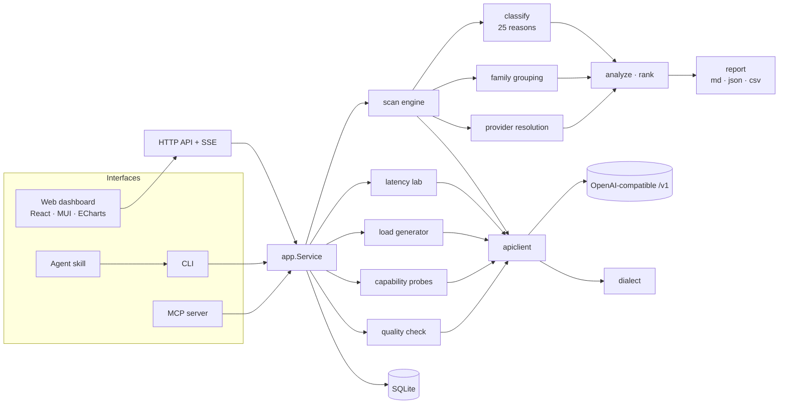

- **Go 1.26**, standard library HTTP server, SQLite via `modernc.org/sqlite` (pure Go, no CGO), single static binary
  with the web UI embedded (`go:embed`).
- **React 19 + Vite + TypeScript + MUI 7 + ECharts 6 + framer-motion**, dual theme that follows the system, zh/en.
- Engines are tested against a scriptable mock gateway (`internal/testutil/mockllm`); the classifier and analyser are
  validated against 168 real gateway errors and the full 2 306-model reference scan.

More: [docs/architecture.md](docs/architecture.md).

## Development

```sh
make web-install && make web   # frontend (Node ≥ 20)
make build                     # bin/llm-speedtest
make check                     # everything CI runs
make screenshots               # regenerate docs/screenshots from `serve --demo`
```

CI runs on Linux, macOS and Windows with the race detector, a coverage gate, golangci-lint, govulncheck, CodeQL,
actionlint, shellcheck, a Docker build and a Playwright end-to-end job. The web UI is tested against API fixtures
recorded from the real server (`make fixtures`): a render matrix mounts every page and tab for every run state
(discovering, running, failed, all-unavailable, finished suite, single stages), plus interaction, SSE, i18n and
style-guard tests with coverage thresholds. Tags `v*` publish GitHub releases (6 platforms, checksums, skill zip)
and a multi-arch image on GHCR. See [CONTRIBUTING.md](CONTRIBUTING.md).

## Roadmap

- Scheduled monitoring runs with trend charts and alerting
- Cross-endpoint comparison of the same model family
- Cost estimation from pricing metadata where gateways expose it
- Pluggable quality sets and judge-model scoring (opt-in)
- Additional dialects as evidence collectors (not alias tables)

## Acknowledgements

Metric definitions follow [genai-perf](https://github.com/triton-inference-server/perf_analyzer) and
[llmperf](https://github.com/ray-project/llmperf); the load modes borrow from the many open-source token/s
benchmarks; the UI takes cues from [FlClash](https://github.com/chen08209/FlClash)'s Material 3 design.

## License

[AGPL-3.0-only](LICENSE). Running a modified version as a network service means sharing your changes under the same terms.
