<p align="center">
  
</p>

<h1 align="center">llm-speedtest</h1>

<p align="center">
  <b>面向任意 OpenAI 兼容 LLM API 的可用性 · 延迟 · 负载 · 能力 · 质量测速套件。</b><br>
  一个静态二进制：CLI、交互式数据看板、详尽的 Markdown 报告、MCP 服务器与可安装的 AI 技能。
</p>

<p align="center">
  <a href="https://github.com/AnnaofArendelle/llm-speedtest/actions/workflows/ci.yml"></a>
  <a href="https://github.com/AnnaofArendelle/llm-speedtest/releases/latest"></a>
  <a href="https://goreportcard.com/report/github.com/AnnaofArendelle/llm-speedtest"></a>
  
  <a href="https://github.com/AnnaofArendelle/llm-speedtest/pkgs/container/llm-speedtest"></a>
  <a href="docs/skill.md"></a>
  <a href="LICENSE"></a>
</p>

<p align="center">
  <a href="README.md">English</a> ·
  <a href="#快速开始">快速开始</a> ·
  <a href="#截图">截图</a> ·
  <a href="#扫描是怎么做的">工作原理</a> ·
  <a href="docs/metrics.md">指标口径</a> ·
  <a href="docs/skill.md">AI 技能</a> ·
  <a href="docs/api.md">HTTP API</a>
</p>

<picture>
  <source media="(prefers-color-scheme: dark)" srcset="docs/screenshots/dashboard-dark.png">
  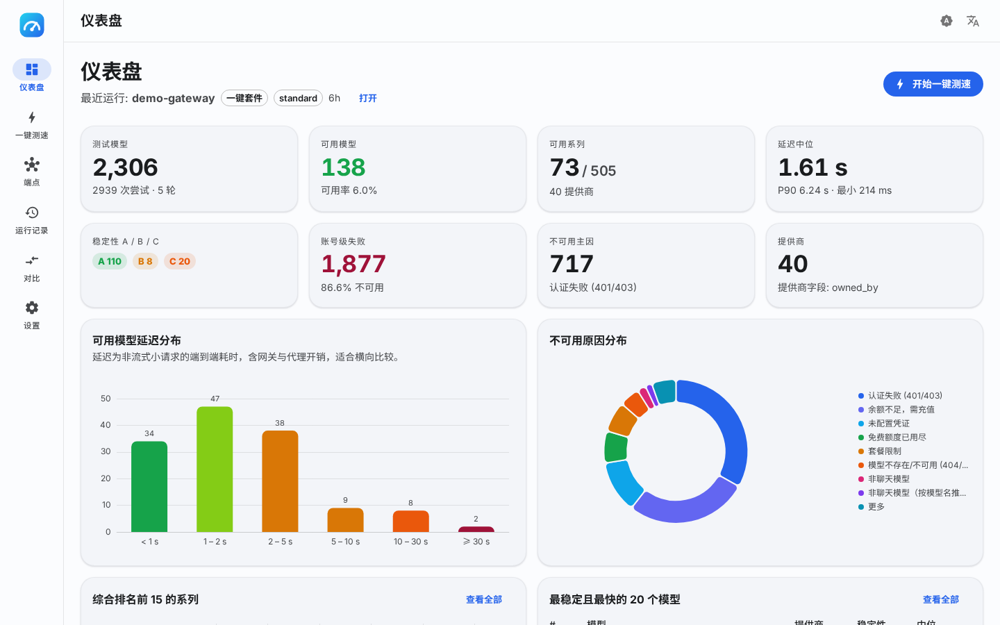
</picture>

## 为什么需要它

网关和路由器会大方地列出成百上千个模型，其中很多早已失效、被锁定、额度耗尽、挂羊头卖狗肉或者慢得离谱；而一次请求
根本说明不了稳定性。llm-speedtest 源自对一个 2 306 模型多提供商网关的真实审计，并把那套方法做成了工具：

- **多轮可用性扫描。** 每个模型经过多轮探测：全量 → 瞬时失败复测 → 成功项补采样 → 最终确认，并带有每提供商并发限制与
  锁定感知的冷却。"可用"意味着*反复*可用。
- **25 类可操作的失败原因。** 自动拆开网关包装，对上游报错归因（鉴权、余额、未配置凭证、免费额度耗尽、非聊天模型、上游 5xx、
  超时……），让你知道该换 Key、充值还是下线路由。
- **真正回答问题的排名。** 系列按 *稳定性 × 提供商广度 × 速度* 做综合排名，也可按稳定性单独排名；每个模型根据多轮成功率获得 A/B/C 等级。
- **不内置任何固定表。** 提供商与系列完全根据端点返回的数据推断（`owned_by`、id 前缀、报错中的连接标识、实际返回的模型名、
  上下文长度），并可按端点修正。新网关、新别名、新命名方式开箱即用，没有需要维护的别名表。
- **需要时可以更深。** 流式延迟实验室（TTFT、TPOT、tok/s）、闭环/开环负载测试与 goodput、13 项能力探针，以及可发现"挂羊头"模型的
  确定性质量抽检。
- **同时服务于人和 AI。** 看板与 Markdown/JSON/CSV 导出给人看；`--json` 输出、MCP 服务器和 [Agent Skills](https://agentskills.io)
  技能包给 AI 助手用。

## 功能一览

| 模块 | 做什么 | 看板 |
|---|---|---|
| **端点管理** | 多端点档案、方言自动识别、Key 加密存储、连通性/鉴权检查、模型预览 | 端点卡片 |
| **可用性扫描** | 发现 → 过滤 → 多轮探测 → 失败归因 → 动态系列归并 → 分级 → 综合排名 → 提供商识别 | KPI 卡片、延迟直方图、原因环图、综合/稳定性排名、全模型表、提供商表、不可用清单、系列抽屉 |
| **延迟实验室** | 流式请求：TTFT、首二 token 间隔、TPOT、ITL、E2E、解码 tok/s（N−1）、输入处理速率、冷启动、p50–p99 | 仪表、分组柱图、逐模型统计 |
| **负载测试** | 闭环并发 sweep 或开环泊松速率、ramp-up、请求/token 吞吐、错误率、SLO 下的 goodput | 并发 → 吞吐/延迟曲线 |
| **能力探测** | 流式、`include_usage`、工具调用、JSON 模式、JSON Schema、视觉、系统提示、`max_tokens`、`stop`、确定性、推理参数、长上下文梯度、embeddings | 能力矩阵 |
| **质量抽检** | 约 20 道确定性题目（YAML 可扩展）、多次试验、一致性、自述身份 | 分数表 + 分类通过率 |
| **一键套件** | 扫描 → 延迟（前 N）→ 能力 → 质量 → 可选负载，一条命令或一次点击 | 带实时 SSE 进度的综合看板 |
| **导出与对比** | 沿用详尽结构的 Markdown 报告、带 schema 版本的 JSON、CSV、两次运行对比 | 导出页、对比页 |
| **AI 技能与 MCP** | `SKILL.md` 技能包、含 20 个工具的 MCP 服务器（`llm-speedtest mcp`）、一键安装 | — |
| **演示模式** | `serve --demo` 载入脱敏的参考扫描数据，无需端点即可体验 | — |

## 截图

<table>
  <tr>
    <td width="50%">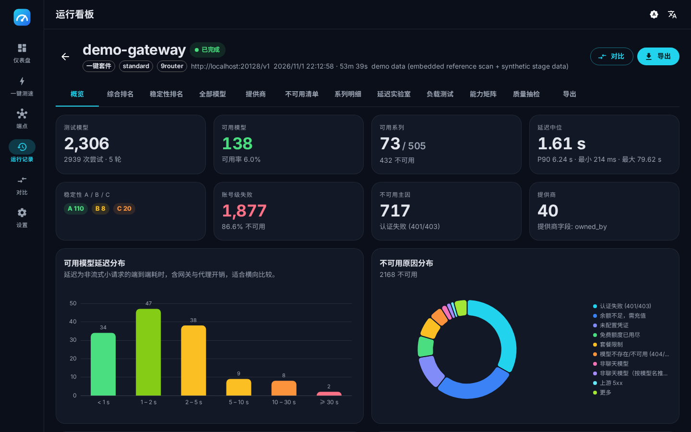</td>
    <td width="50%">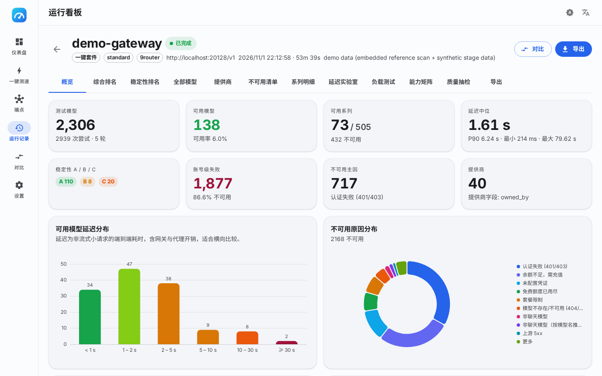</td>
  </tr>
  <tr><td align="center">运行概览 · 深色</td><td align="center">运行概览 · 浅色</td></tr>
  <tr>
    <td>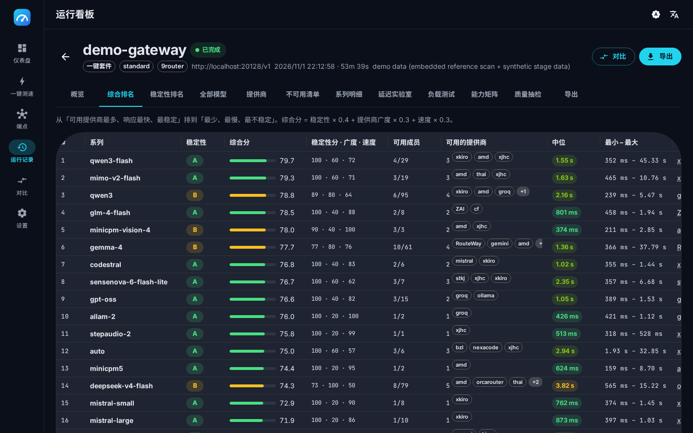</td>
    <td>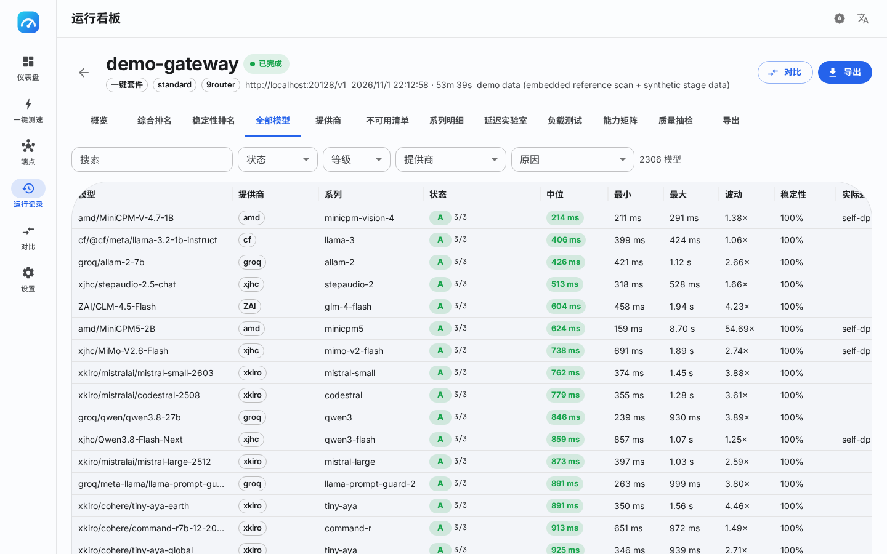</td>
  </tr>
  <tr><td align="center">系列综合排名</td><td align="center">全部模型（筛选 + 服务端排序）</td></tr>
  <tr>
    <td>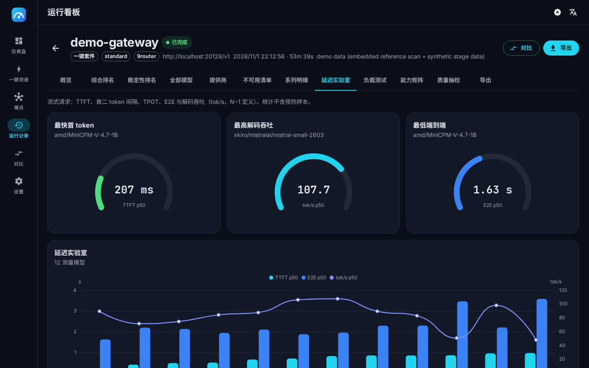</td>
    <td>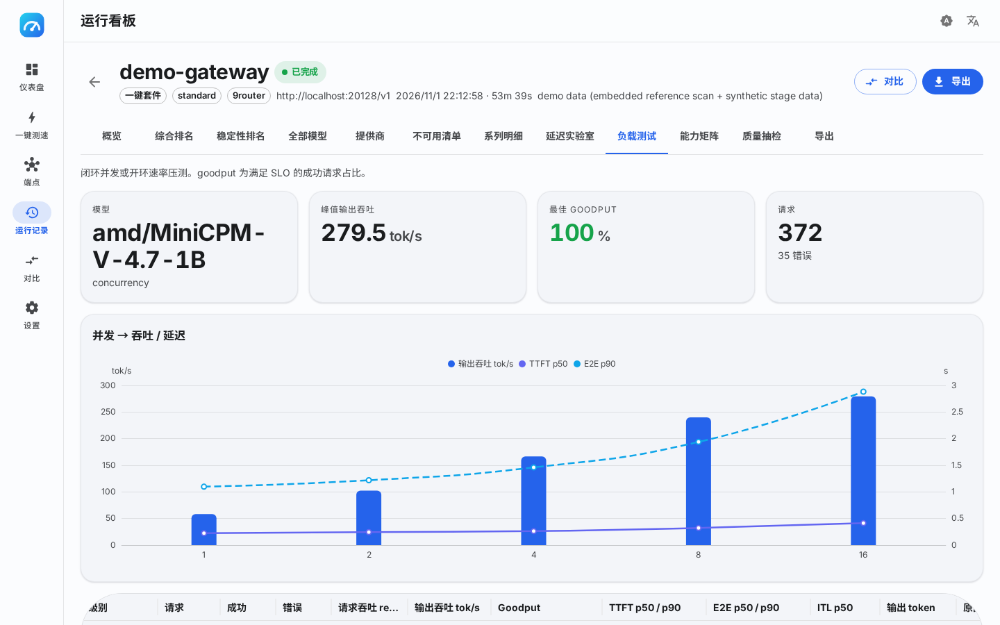</td>
  </tr>
  <tr><td align="center">延迟实验室</td><td align="center">负载测试</td></tr>
  <tr>
    <td>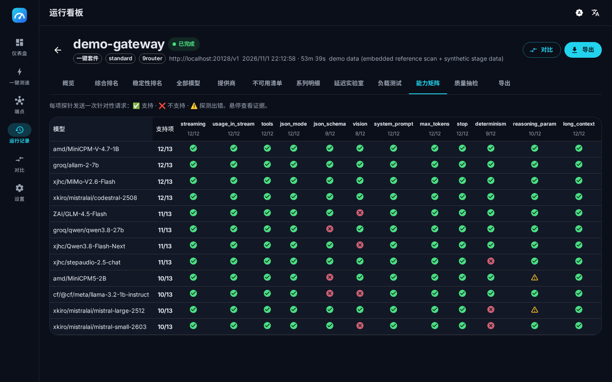</td>
    <td>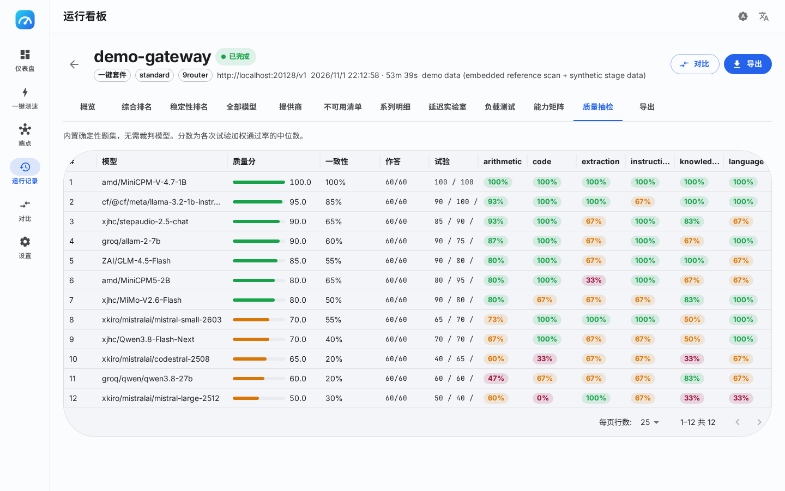</td>
  </tr>
  <tr><td align="center">能力矩阵</td><td align="center">质量抽检</td></tr>
  <tr>
    <td>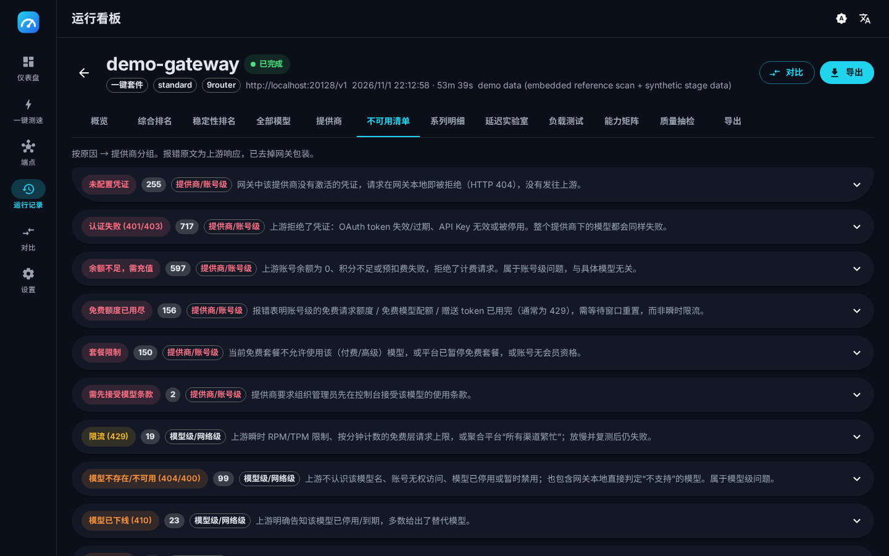</td>
    <td>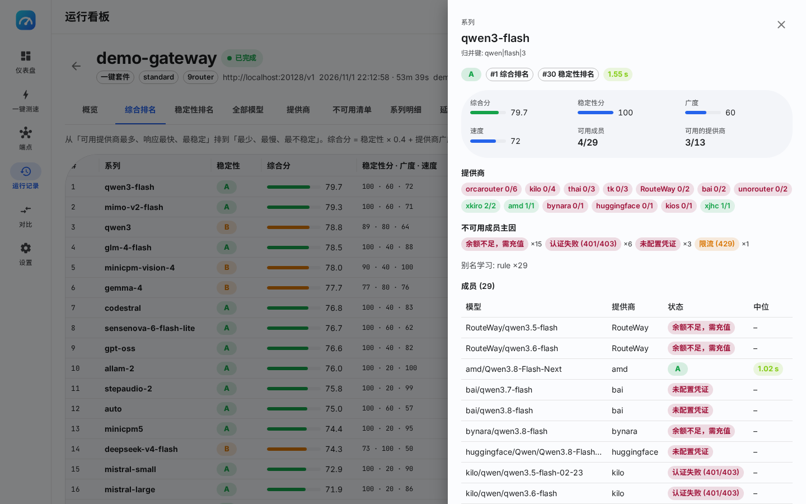</td>
  </tr>
  <tr><td align="center">按原因 → 提供商分组的不可用清单</td><td align="center">带归并依据的系列抽屉</td></tr>
  <tr>
    <td>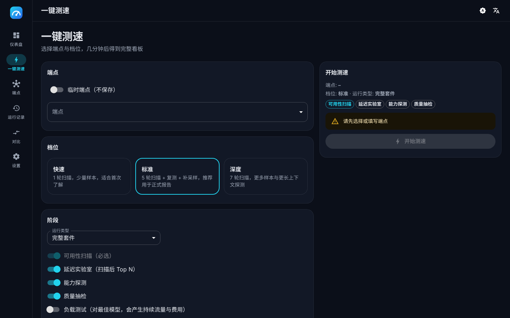</td>
    <td>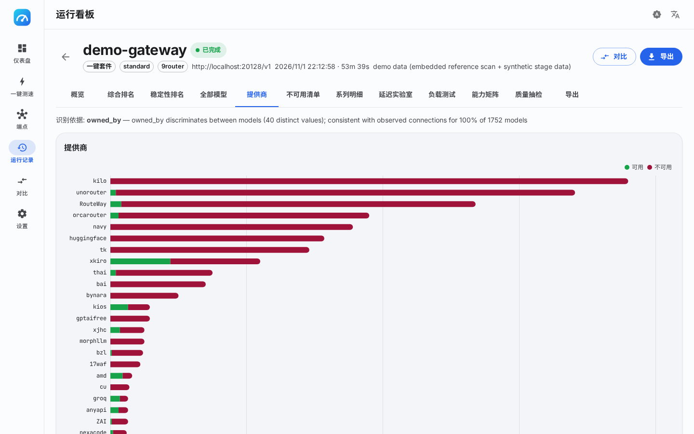</td>
  </tr>
  <tr><td align="center">一键测速向导</td><td align="center">带识别证据的提供商页</td></tr>
</table>

<p align="center">
  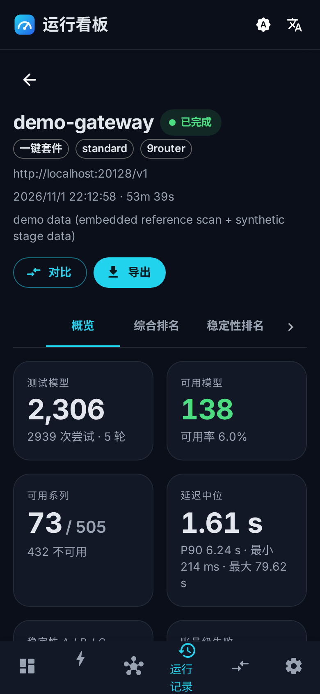
  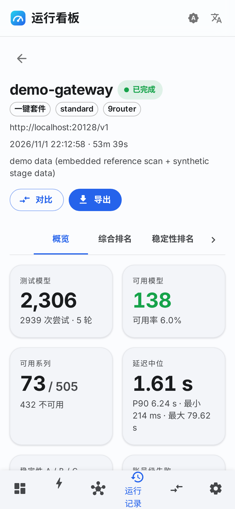
</p>

## 快速开始

### 安装

```sh
# Linux / macOS —— 最新 Release，自动校验 checksum
curl -fsSL https://raw.githubusercontent.com/AnnaofArendelle/llm-speedtest/main/scripts/install.sh | sh

# Docker（多架构；数据保存在卷中）
docker run --rm -p 8787:8787 -v llm-speedtest:/data ghcr.io/annaofarendelle/llm-speedtest:latest

# Windows —— 从 Releases 页面下载 zip
```

Release 二进制与容器镜像都内嵌了 Web 看板。`go install github.com/AnnaofArendelle/llm-speedtest/cmd/llm-speedtest@latest`
可得到 CLI、HTTP API 与 MCP 服务器（不含看板；需要的话先执行 `make web`）。

### 1 · 打开看板

```sh
llm-speedtest serve            # http://127.0.0.1:8787
llm-speedtest serve --demo     # 用内置参考数据体验 UI
```

添加端点（以 `/v1` 结尾的 Base URL + Key），点击 **一键测速**，选择档位，结果会实时流入看板。

### 2 · 或者在终端里跑

```sh
export LLM_SPEEDTEST_KEY=sk-...

# 全套：扫描 → 延迟 → 能力 → 质量，并导出 Markdown + JSON
llm-speedtest suite --url https://gateway.example.com/v1 --profile standard --out report.md --json-out report.json

# 只扫描部分提供商，快速档
llm-speedtest scan --url http://localhost:20128/v1 --include-owner groq --include-owner cf --profile quick

# 指定模型的流式延迟
llm-speedtest latency --url https://gateway.example.com/v1 --model openai/gpt-oss-120b --samples 10

# 负载测试（会产生持续流量，必须显式确认）
llm-speedtest load --url https://gateway.example.com/v1 --model openai/gpt-oss-120b --levels 1,2,4,8 --duration 30s --confirm

# 历史运行、报告与对比
llm-speedtest runs
llm-speedtest report --run <id> --format md --lang zh
llm-speedtest compare --a <id> --b <id>
```

```
scan  round 1/5 (first)    1240/2306  ✓ 131  ✗ 1109  eta 2m10s
scan  round 2/5 (retry)     208/208   ✓ 7    ✗ 201
...
models 2306 · available 138 (6.0%) · A/B/C 110/8/20 · families 505 (73 available) · median 1.61s
```

所有命令都支持 `--config speedtest.yaml`（见 [`examples/speedtest.yaml`](examples/speedtest.yaml)），并可用
`--json` / `--json-out` 输出机器可读结果。

### 3 · 交给 AI 助手

```sh
llm-speedtest skill install --target claude   # 或 codex | cursor | <目录>
llm-speedtest mcp                              # 通过 stdio 提供 MCP 服务
```

安装技能后，直接问助手"http://localhost:20128/v1 上哪些模型真的能用、哪些最快？"——它会自己跑扫描、读取排名并写出结论。
详见 [docs/skill.md](docs/skill.md) 与 [docs/mcp.md](docs/mcp.md)。

## 扫描是怎么做的

| 轮次 | 目的 | 默认（standard 档） |
|---|---|---|
| 1 · first | 全量探测每个模型一次（`max_tokens: 1`，提示词 `hi`） | 全局 10 / 每提供商 2，超时 60 s |
| 2 · retry | 冷却后复测瞬时失败（超时、5xx、限流） | 6 / 1，90 s |
| 3..N · resample | 对成功项补采样以衡量稳定性与波动 | 额外 2 轮 |
| final | 对至少成功过一次的模型做最终确认 | 4 / 1，90 s |

每次尝试都记录 HTTP 状态、上游状态、连接标识、延迟、实际返回模型与归因结果。分析器据此得到：

- **模型等级**：多轮成功率 **A** ≥ 99.9%、**B** ≥ 66%、**C** 更低。
- **系列**：分词规则（版本折叠、规模/量化去除、修饰词处理）+ 从实际返回模型名学习别名 + 基于端点自身词表的缩写展开 +
  按端点覆盖；`auto`、`free` 一类通用伪模型永远不会吞并其他系列。
- **提供商**：在 `owned_by`、id 前缀与端点本身之间，选择*区分度*最高且与报错中连接标识*最一致*的字段作为主键。
- **综合分** `= 0.4 · 稳定性 + 0.3 · 提供商广度 + 0.3 · 速度`，速度按 0.5 s（100 分）到 30 s（0 分）的对数刻度计算，权重可配。

Markdown 导出完整沿用原始审计报告的结构：结论摘要、领先榜、延迟分布、提供商总览、综合与稳定性排名、全员不可用系列、全部可用模型、
按原因 → 提供商分组并附报错原文的不可用清单、系列明细与口径说明。

## 指标速查

| 指标 | 定义 |
|---|---|
| **TTFT** | 请求发出到首个内容 token |
| **TTST** | 到第二个 token 的时间（排队 + 首次解码） |
| **TPOT** | `(t_done − t_first_token) / (N − 1)`，首 token 之后的平均每 token 时间 |
| **ITL** | 逐块的 token 间延迟（均值） |
| **E2E** | 请求发出 → 流关闭 |
| **tok/s** | `(N − 1) / (t_done − t_first_token)`，单请求解码吞吐 |
| **输入 tok/s** | 提示 token 数 / TTFT |
| **Goodput** | 负载下满足 SLO（TTFT、TPOT、E2E）的成功请求占比 |

token 数优先取 `stream_options.include_usage` 返回的 `usage`；服务端不提供时按字符估算并标注。完整口径见 [docs/metrics.md](docs/metrics.md)。

## 网关方言

方言只描述*结构*——报错如何包装、有哪些健康接口——绝不包含提供商或模型名称表。

| 方言 | 识别依据 | 额外能力 |
|---|---|---|
| `generic` | 任意 OpenAI 兼容 `/v1` | — |
| `9router` | `/api/version`、`[conn/model] [status]: …` 包装 | 嵌套解包、锁定 `reset after` 提示、连接标识作为提供商证据 |
| `oneapi`（one-api / new-api） | `(request id: …)` 包装 | 去除 request id |
| `openrouter` | `error.metadata`、价格字段 | 上下文/价格元数据 |
| `litellm`、`vllm`、`ollama` | 健康接口与模型元数据 | — |

用 `--dialect` 强制指定，或留空自动识别。

## 提供商与系列：数据驱动

- **提供商**页展示所选主键字段与依据（例如"owned_by 可区分 40 个取值，且与 1 877 条报错中的连接标识一致"），悬停可见证据。
- 可在 UI、HTTP API 或 MCP 中重命名/合并提供商、把模型重新归入系列；覆盖按端点保存并作用于该端点的所有运行。
- 当两个键共享连接标识或报错域名时引擎会给出合并建议，但绝不悄悄合并。

详见 [docs/providers-and-families.md](docs/providers-and-families.md)。

## 配置

```yaml
endpoint:
  name: my-gateway
  base_url: http://localhost:20128/v1
  api_key: ""           # 或环境变量 LLM_SPEEDTEST_KEY
  dialect: ""           # 自动识别
suite:
  profile: standard     # quick | standard | deep
  latency_top: 10
  load: false
  filter: { exclude_owners: [combo], id_regex: "" }
  specs:
    scan: { first: { concurrency: 10, per_provider: 2, timeout: 60s }, resample: 2 }
    latency: { samples: 5, warmup: 1, input_tokens: 200, output_tokens: 128 }
    load: { mode: concurrency, levels: [1, 2, 4], duration: 30s, slo: { ttft: 1s, tpot: 50ms } }
    scoring: { w_stability: 0.4, w_breadth: 0.3, w_speed: 0.3 }
```

命令行参数优先于文件；`llm-speedtest config example` 打印完整配置。详见 [docs/configuration.md](docs/configuration.md)。

## HTTP API

`llm-speedtest serve` 通过 HTTP（`/api/…`）暴露同一套引擎，并用 Server-Sent Events 推送实时进度：

```
POST /api/runs                     启动运行（suite | scan | latency | load | capability | quality）
GET  /api/runs/{id}/events         SSE：轮次、尝试、样本、进度、完成
GET  /api/runs/{id}/summary        KPI、评分、领先系列/模型、提供商
GET  /api/runs/{id}/families       综合或稳定性顺序
GET  /api/runs/{id}/models         筛选 · 排序 · 分页
GET  /api/runs/{id}/report.md      Markdown 导出（?lang=zh|en）
GET  /api/compare?a=…&b=…          两次运行对比
```

对外暴露时请使用 `--access-token`。参考：[docs/api.md](docs/api.md)。

## 退出码

| 退出码 | 含义 |
|---|---|
| 0 | 成功 |
| 1 | 运行错误 |
| 2 | 用法错误 |
| 3 | 端点不可达或鉴权失败 |
| 4 | 被取消（SIGINT / SIGTERM） |
| 5 | 可用率低于 `--fail-under`（CI 门槛） |

## 架构

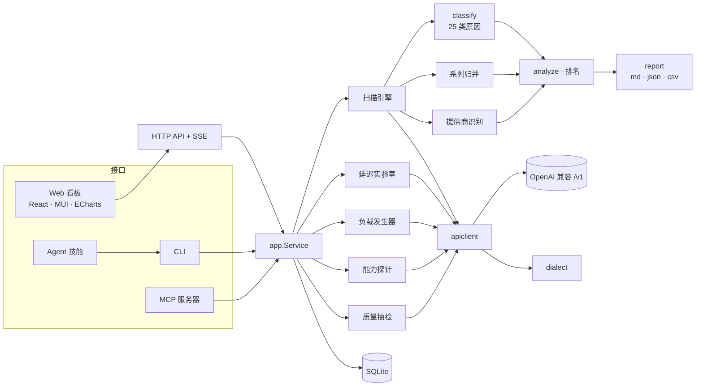

- **Go 1.26**，标准库 HTTP 服务器，`modernc.org/sqlite`（纯 Go，无 CGO），`go:embed` 内嵌 Web UI 的单一静态二进制。
- **React 19 + Vite + TypeScript + MUI 7 + ECharts 6 + framer-motion**，跟随系统的双主题，中英双语。
- 各引擎均针对可脚本化的仿真网关（`internal/testutil/mockllm`）测试；归因器与分析器用 168 条真实网关报错与完整的 2 306 模型参考扫描对账。

更多：[docs/architecture.md](docs/architecture.md)。

## 开发

```sh
make web-install && make web   # 前端（Node ≥ 20）
make build                     # bin/llm-speedtest
make check                     # 跑一遍 CI 的全部检查
make screenshots               # 从 `serve --demo` 重新生成 docs/screenshots
```

CI 在 Linux、macOS、Windows 上运行，包含竞态检测、覆盖率门槛、golangci-lint、govulncheck、CodeQL、actionlint、shellcheck 与
Docker 构建。推送 `v*` 标签即自动发布 GitHub Release（6 个平台、checksums、技能 zip）与 GHCR 多架构镜像。
详见 [CONTRIBUTING.md](CONTRIBUTING.md)。

## 路线图

- 定时监控运行、趋势图与告警
- 同一系列在多个端点之间的横向对比
- 基于网关价格元数据的成本估算
- 可插拔题集与（可选的）裁判模型评分
- 更多作为"证据采集器"而非别名表的方言

## 致谢

指标定义参考 [genai-perf](https://github.com/triton-inference-server/perf_analyzer) 与 [llmperf](https://github.com/ray-project/llmperf)；
负载模式借鉴了众多开源 token/s 测速工具；UI 风格参考 [FlClash](https://github.com/chen08209/FlClash) 的 Material 3 设计。

## 许可证

[AGPL-3.0-only](LICENSE)。以网络服务形式运行修改版本时，需要以相同条款公开你的修改。
